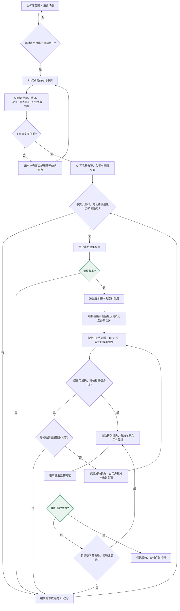
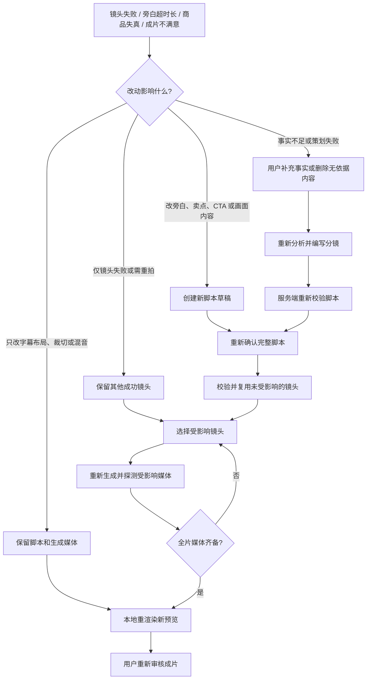

# AI 商品广告全流水线设计（待审计）

状态：完整业务与交互规格，待用户审阅，**不代表已实现**。范围：单商品、15/30 秒、9:16、3–5 镜头。本方案扩展[现有 C 阶段设计](2026-11-04-advertising-generation-design.md)中排除的 AI 编写脚本和批量生产；已有手工流程、确认修订、任务、账务、资源及 FFmpeg 时间线保持有效。

## 1. 目标、取舍与完整流程

用户只上传已就绪的商品主图、写一句大致场景；系统自动提取事实、策划广告、写全部分镜及文案、生成并粗剪。创作主流程只有脚本确认和成片验收两个内容确认点；制作费用约束作为独立的执行规则处理，不插入创意策划。关键事实冲突或生成失败才暂停请求处理。

方案比较：单次大提示词省调用但事实与分镜无法独立校验；多 Agent 争论或先选三概念增加成本和等待；**推荐两阶段结构化策划**（事实/策略、完整脚本）加确定性服务端校验，复用既有任务和时间线，不建通用工作流引擎。

输入 → 商品事实与广告策略 → AI 全镜头脚本 → 结构/能力校验 → **确认脚本**（冻结版本）→ 编制制作任务 → 生成旁白与视频并探测 → 自动粗剪预览 → **人工验收成片**。策划不单列报价或用户费用授权；实际视频生成的费用控制另见第 5 节，不改变这条创作链。

## 2. 商品输入与有证据的广告策略

必填：一张当前用户可读的已就绪商品图、一句场景/广告意图。选填：商品/品牌名称、用户已核实卖点及依据、受众、投放目标及承接入口（商品详情/门店/预约/品牌曝光）、其他图片、风格/禁用词、旁白、时长、授权音乐。默认 15 秒、无旁白。图片可观察外观与包装可见文字可作为视觉事实；OCR 结果、不可见成分、功效、价格、认证、优惠只作待核实线索，不自动成为已证实宣称。

策略产物：目标、受众、使用场景、单一价值主张、Hook、卖点及每条证据来源（用户原话/素材 ID 与可见位置/明确提供的资料）、证据展示方式、品牌记忆点、画面与合规约束、呈现密度，以及 CTA 的动作/准确文案/真实承接位置。用户声明与可观察事实分级记录；未知卖点直接不采用，只有缺失信息会使广告无法成立才追问。模型不能代替法务对医疗、金融等高风险宣称背书。

**品牌标语不是 CTA。** “给自己留一杯时间”是标语；“查看商品详情”只有投放位存在详情入口才能作为 CTA。无可证实承接入口时标记 CTA 待确认，在脚本审核中询问实际动作；品牌曝光可明确标为无点击 CTA，采用品牌记忆目标。禁止虚构购买链接、门店、库存、优惠或功效。脚本审核页须同时展示目标、Hook、卖点依据、CTA 及风险。

## 3. AI 策划、分镜与校验

阶段 A：受管多模态模型读取授权图片和需求，输出事实记录与广告策略。阶段 B：受管模型读取 A 的结构化结果、原始授权需求及候选视频模型能力快照，输出**一个**推荐创意和全部镜头。两阶段强类型解析、字段校验及持久化；失败显示已完成阶段与具体错误，不自动无限重试模型调用。用户明确要求“换方向”时才重新运行策划。模型输出只是内容建议，不能决定渠道、真实权限或执行请求；内部模型调用限额由服务端控制，不作为用户策划报价。

每镜头含稳定 shot ID、内容职责、正时长、商品/场景/动作/景别/运镜、可见证据、末帧连续性、精确文字/可选旁白及绑定参考素材 ID。15 秒建议 Hook → 展示/证据 → 品牌与 CTA；30 秒可以展开，但不是强制的物理生成切片。服务端将冻结商品外观约束、全片风格、本镜头内容和明确绑定的真实图片组装最终视频提示词；“同一商品”文字不能代替参考图绑定。字幕、Logo 与 CTA 用后期准确叠加，不交给视频模型绘制。

服务端在脚本展示和确认前检查 3–5 镜头、唯一 ID、正时长合计精确等于 15/30 秒、引用资源归属与类型/状态、卖点事实来源、CTA 与目标/承接位置一致；按模型能力检查 9:16、可用时长档位及参考图数量。策划时用能力快照，制作报价时重验实时能力、路由及价格；变化须调整/重报价，不自动换模型。旁白长度估计仅为编辑提示，不能把英文 words/s 当中文字/s；TTS 后探测真实音频时长。静态校验无法证明创意美感或画面真实。

## 4. 脚本关与不可变版本

审核页先展示“卖什么、凭什么、希望观众做什么”，再看整条节奏、逐镜头画面/时长/参考图/文字/旁白。用户可直接编辑或要求定向 AI 改写；改写是候选差异，不覆盖人工编辑。点击“确认脚本”时服务端用 expectedRevision 校验并冻结完整脚本、策略与资源引用；冲突返回 409，要求对照最新草稿。旧确认版本、任务、费用与成片保留。更改已确认画面、CTA、旁白或事实，必须创建新修订并再次走脚本关。

现有 AdvertisingDraft 的 brief/brand/shots 与确认修订继续作为可编辑、可制作的脚本；策略/事实证据和策划运行仅增补必要的关联产物，不塞入 visual 自由文本。手工项目无须补 AI 元数据。审计留模型、提示词模板、能力快照、事实来源及修改者，不存供应商密钥/临时签名 URL。新修订使旧未批准报价过期，不能删除已发生的历史消费和媒体。

## 5. 批量生产报价、授权和幂等

从**指定确认修订**编译生产清单：各镜头视频模型、时长档位、9:16 规格、最终 prompt、参考资源、按需 TTS 的固定文案/音色/模型、可复用结果、各项报价与总上限。若模型只有长于目标镜头的档位，报价展示实际生成时长与裁切成本，并在视频探测确认长度足够后按冻结镜头时长确定性裁切；无可用档位则阻断，不暗改片长。空旁白不下 TTS 任务。模型/图像不可用、规格不支持、报价无法可信取得或费用未覆盖时阻断。本节只约束视频/TTS 制作任务；不能以供应商估计价伪装执行层能强制的硬上限。

批准时冻结修订 ID、每项输入/模型/能力/价格签名、允许任务次数、有效期、批准人和整批上限，记录 plan hash。**每项目仅批准一次收费尝试**；失败重试、换渠道、追加镜头、改规格或补做均须新报价和新授权。服务端重新验证归属、报价、余额/配额、能力和修订，任何变化不派发并提示新报价。批次及每项具备持久唯一操作键；重放返回原任务及真实订单，断线刷新不重扣。取消仅尽力阻止未发项，已派发任务费用以真实账务终态为准。

优先在准入前预留全部计划额度；若账务不能保证整批原子预留，则逐项预留且任何项目准入失败都暂停余项，记录已发/未发/实际费用/剩余预留，不宣称整批原子完成，也不突破批准的剩余额度。批准与任务映射必须在服务端持久化，不能靠浏览器循环现有逐镜头付费接口。失败只保留其他成功项，补做需重新批准受影响项目；不自动收费重试。

## 6. 生成、粗剪与成片关

无旁白时在并发上限内执行视频；有旁白时先做 TTS 并探测真实时长。超过已确认镜头时长则暂停相关视频任务与组装，提出缩短旁白并新修订确认或新报价调整镜头；不擅自截断、加速或延长广告。未派发项目按现有账务规则释放预留；已完成镜头及音频保留。

视频完成后做可访问、可解码、有效时长和适配画幅的技术探测。基于该批成功结果生成**仅供预览的候选选用快照**，复用现有时间线、媒体探测和 FFmpeg 合成完整 MP4；不隐式覆盖既有人工采用的镜头。缺少任何必需镜头只显示局部结果，不能标完整预览。视觉 QC 可以标注商品变形/场景突变/文字乱码风险，不等于人工验收，也不能自行花钱修复。只采用用户有权使用的音乐；默认不猜测背景音乐版权。

最终页优先播放整条视频，附脚本来源、CTA、镜头风险和实际费用。用户显式“验收成片”，或只改字幕布局、裁切、混音并重渲染；若改变镜头画面、旁白、CTA 等脚本内容，则产生新修订、重过脚本关，只为受影响的生成项重新报价。跨修订复用旧结果须验证同项目、用户权限、完整输入语义 hash、参考图及模型规格，并记录来源任务和用户选择；不匹配就重生成。商品身份或整片风格变化应提示所有受影响镜头。自动粗剪不是人工验收，旧预览及成片保留可追溯。

## 7. 状态、接口与持久化边界

策划：analyzing → scripting → ready/blocked/failed；脚本：draft → confirmed(revision)；批次：quoted → approved → running → partial/blocked/preview_ready/failed；预览：rendering → ready → accepted/render_failed。状态从真实任务、账单、媒体探测推导，不能由前端自报成功。输入/事实变化使策划和脚本过期；脚本变化使未批准制作报价过期；能力/价格变化使报价过期；仅后期字幕/混音变化只使渲染过期。过期不等于退款或删除历史。

沿现有广告项目路由增加策划启动/查询/候选采纳、批次报价/批准/进度/补做、预览/验收 API；复用现有保存及确认脚本。写接口带 expectedRevision 与 clientOperationId；409 给可重取的真实状态。handler 解析鉴权，app 组织流程，repository 管持久化；继续使用受管 Task、订单、资源、媒体探测和 FFmpeg。只增补策划运行/策略与事实、批次授权/任务映射、预览快照/验收所需持久状态，不造第二套任务、文件或账务系统。具体表、索引、迁移版本在实施计划依据当时 schema 确定，并遵守仓库强制迁移规范。所有输入、模型、资源、产物和价格在服务端核验归属、权限和真实性；用户图片及文本不得提升工具权限、改系统规则或授权费用。

## 8. 可执行验收与审计案例

1. 一张主图加一句场景能自动产出含 Hook、卖点证据、品牌及匹配承接入口的 CTA 的 3–5 镜头脚本；用户无需手填镜头。
2. “零糖”“限时半价”等无证据宣称、无购买入口的“立即购买”不能进入已确认脚本。
3. 双击批准、断网后重放、过期报价、能力变化及余额不足均不会重复收费或突破批次额度；账单与批准项可逐个对账。
4. 有旁白且真实 TTS 超镜头时长时停下相关视频和合成；空旁白无 TTS；不自动加速、截断或延长。
5. 某镜头失败后其他成功项保留；补做只报该项。缺镜头无完整预览，自动预览未标人工验收。
6. 字幕/混音变化只重渲染；第二镜头内容变化新脚本确认后仅为受影响镜头报价，复用其他项需来源及身份校验。
7. 非本用户图像、伪造引用/模型/报价、过期修订及冲突写入均由后端拒绝；刷新仍能恢复真实任务、支出和失败原因。

## 9. 实施与参考边界

推荐依次交付：策划与脚本、批次审批与收费、自动粗剪与验收；每阶段覆盖合同/权限/费用幂等测试，最终以真实 15 秒竖屏商品广告验收，同步 API、数据库及用户文档。这是**设计方案**，没有进行模型调用、迁移或产品实现。首版暂缓三创意选择、多 Agent 辩论、自动关键帧、付费自动重试、自动法务判定、多商品、自动发布。借鉴 [Genflow Ad Studio](https://github.com/debanshd/ad-gen) 的商品图到广告主链路、[Trendlume](https://github.com/colind0pe/Trendlume) 的素材锁定与局部重做、[Commercial Creator](https://github.com/cxbxmxcx/commercial-creator) 的付费前批准与 QC 后暂停；不照搬自动付费重试、供应商绑定或额外审批关。项目行为以真实代码和各自许可证为准，参考不代表已在本仓验证运行效果。

## 10. 广告视频生成流程

一个项目允许多次策划候选、多份确认脚本和多批生产；以下只描述从输入到成片的创作链。

### 广告视频生成主流程

绿色节点仅表示脚本与成片的人工确认。

### 失败与修改回路

缺少必需镜头不能生成可验收的完整预览；视觉 QC 只标出风险，不自动重拍。

| 阶段 | 输入与操作者 | 产出与可继续条件 | 暂停/返回 |
| --- | --- | --- | --- |
| 需求 | 用户上传商品主图并输入场景；系统确认素材 ready 与归属 | 持久草稿和资源绑定；直接启动策划 | 图片损坏/无权限则重新上传；未调用模型 |
| 事实/策略 | AI 读取图与输入，服务端核验事实来源 | 可追溯商品事实、受众、目标、Hook、卖点、品牌及 CTA 策略 | 关键事实不足只询问缺项；模型/解析失败展示阶段和原因 |
| 全片脚本 | AI 基于上述策略生成一个完整创意 | 3–5 镜头、镜头职责/时长/画面/文字/旁白/素材；校验通过才可确认 | 校验失败保留原始候选及原因；用户修改或重新运行策划 |
| 脚本确认 | 用户逐镜头编辑或直接确认 | 冻结修订 ID、策略及素材引用；后续制作不读取活草稿 | 改动未保存不可确认；并发修改按 409 对照处理 |
| 任务编制 | 系统从确认脚本生成逐镜头视频提示词和可选 TTS 任务 | 每项绑定素材、模型能力与脚本版本，标明可复用项 | 素材或能力不可用则阻断，不能静默换模型 |
| 自动制作 | 后端派发 TTS/视频并检验真实媒体 | 每项可用媒体通过探测；齐全后自动粗剪导出 | 失败只停依赖项，保留其他成功项 |
| 成片验收 | 用户观看完整预览并显式验收 | 标记该预览版本已验收，可下载/进入既有时间线 | 不满意按影响面重做；无全片媒体不可验收 |

示例：用户上传一张包装上能读到品牌名的杯子照片，输入“通勤场景，15 秒”；系统可以描述可见外形，但**不得凭照片声称保温时长**。若投放位提供真实商品详情入口，AI 可建议结尾“查看商品详情”；否则在脚本关选择真实动作，或将目标明确设为品牌曝光并采用不含点击动作的品牌结尾。确认三镜头脚本后生成对应的视频任务（有旁白才生成 TTS）；媒体校验通过后组装 15 秒预览。第二镜头失败时保留第一/第三镜头，仅处理第二镜头并重新粗剪；用户查看新预览后再验收。

## 11. 页面信息架构与逐屏交互

仍在既有广告项目列表与详情路由内，不另起营销式向导。详情页使用四个稳定步骤“需求 / 脚本 / 制作 / 成片”，但不强制线性导航；每步显示该项目当前状态、来源修订和需要用户决策的下一动作。历史确认/批次/导出提供独立可访问入口，切换历史只读查看，不会暗中切换当前生产来源。手工编镜头入口保留，作为 AI 不可用时的替代路径。

1. **需求屏**：首屏展示商品主图上传区（预览、替换、失败状态）、必填“想要什么场景”的文本框、15/30 秒分段选择；可展开商品事实、品牌、受众、真实承接入口、其他素材与授权音乐。默认 15 秒、无旁白；投放目标由用户输入与 AI 策略决定，脚本关确认；点击“生成整条脚本”直接启动策划。不能把上传成功当资源 ready；切换主图后提示旧策划候选已过期，历史保留。缺少模型时明确展示不可用原因和手工编辑入口。
2. **策划进度**：持续显示“核实商品信息 → 制定广告策略 → 编写整条脚本 → 校验”及各阶段实际状态，不展示虚构百分比。页面关闭/刷新后从服务端恢复同一运行；取消仅停止尚未派发的模型请求。关键事实缺失显示原图和冲突句、要补的一个具体字段，用户补充后仅重跑失效阶段。
3. **脚本屏**：顶部并排显示投放目标、目标观众、核心主张、Hook、卖点/来源与 CTA/承接入口；下面按播放顺序展开全部镜头，始终能看到时长合计。每镜头可编辑画面、文字、旁白、时长与参考图；“改写这一镜头”先展示差异，不直接覆盖人工编辑。“保存草稿”和“确认脚本”分离，确认弹窗汇总版本、时长、商品依据、未解风险；未核实宣称、高风险 CTA 或总时长不符时禁用确认并把焦点定位到错误字段。首版分镜为**文字脚本+现有参考图**，不是未经批准生成的 AI 关键帧图片。
4. **制作屏**：固定显示确认修订和脚本摘要；报价表逐行列镜头、视频/TTS 类型、模型、实际生成档位与需裁切的目标时长、输入图数量、每项报价/费用性质、预计合计和最高可执行额度；复用项明确标记“零次新生成”并可查看原任务。批准对话框重列总上限、所选任务数、过期时间和“仅批准这一清单”；金额/能力变更返回报价页，不接受弹窗中途静默替换。启动后逐行显示排队、运行、探测、成功/失败及实际消耗；任务列表提供筛选和失败原因，取消只停止未开始的部分。
5. **成片屏**：优先给完整视频播放器与来源修订、实际总费用、时长、CTA 和风险标记；旁边是紧凑镜头列表，选择镜头能定位预览。可作后期调整（字幕排版、裁切、授权音乐/音量）并明确“只重渲染”；改旁白、画面、卖点、CTA 则提示“将创建新脚本修订并需重新确认”。“验收成片”只在完整且可解码的导出就绪时可用，验收后显示验收人、时间及来源批次，历史预览仍可找回。下载与验收是不同命令，不以下载推定验收。

流程按钮按动作命名（“确认脚本”“批准本批费用”“验收成片”），图标仅用于刷新、打开历史、下载等明确工具，并提供可见名称/提示。步骤状态同时用文字和图标区分，失败信息就近显示原因和恢复按钮。手机端单列且操作区保持可见；报价表用逐项展开行而不是横向溢出。键盘可达上传、分镜、报价和确认；通知用适当的 status/alert，不靠颜色或动画传达付费和失败状态。沿用现有 Ant Design、页面 token 与窄屏布局，不新增独立组件库。

## 12. 决策与恢复交互矩阵

| 触发 | 页面呈现与用户决策 | 服务端约束 |
| --- | --- | --- |
| 策划模型不可用 | 保留输入、指出哪个阶段不可用；允许手工编写，不显示空白脚本为成功 | 不跳过商品事实核验；不自动换模型 |
| 商品图与文字冲突 | 展示原图可见位置及用户原话，要求用户核实；无依据卖点可删除继续 | 不把 OCR 推断或模型推断写成已证实事实 |
| CTA 没有真实入口 | 在脚本关询问可执行动作；品牌曝光可选“无需点击 CTA”，结尾只保留品牌识别 | 不能合成虚构链接或营销优惠；目标与 CTA 规则由服务端校验 |
| 策划输出无效 | 展示原阶段、失败原因及原始候选；用户可修改或重新策划 | 不自动无限重试模型调用 |
| 脚本被他人修改 | 保留本地输入，展示本地/服务端版本对照并决定 | CAS 409，不最后写入覆盖 |
| 报价过期/余额不足/能力变化 | 禁用旧批准，标明变动的行和金额，重新报价后再次确认 | 无法约束上限的计价模式不可批准 |
| 刷新/断网/重复点击批准 | 重载同一批次、任务 ID 和账务；显示“恢复中”而非重复生产 | 操作键重放同结果；相同键不同内容冲突 |
| TTS 实测超过镜头 | 展示音频长度与镜头长度、可播放试听；建议缩短旁白并产生新修订 | 未派发相关视频停下；不偷改语速、片长或旁白 |
| 镜头失败或商品失真 | 显示原生成任务/费用/QC 风险；可重写镜头或“只补此项”并获取新报价 | 未批准不再调用收费模型；其他成功项保持 |
| 粗剪/导出失败 | 展示探测或渲染错误、保留原批次与媒体；明确重试本地渲染 | 不当成模型重试，不重扣模型费；旧成功导出不覆盖 |
| 用户要求改成片 | 后期变化直接新预览；脚本语义变化回脚本关，标记影响的镜头及复用依据 | 旧验收记录与费用保留；新预览未自动验收 |

制作费用应显示视频、旁白两类分别的“批准上限 / 已预留 / 已结算 / 未执行”，并说明估计费用与硬上限的区别；服务器算账，不以浏览器合计值决定可扣款。不要用自动刷新覆盖用户正在编辑的脚本或正在查看的历史。

## 13. 状态图、版本依赖与实现边界

主状态按真实产物推进：

	raw_input → analyzing → scripting → script_ready → script_confirmed
	→ production_quote → production_approved → running → preview_rendering → preview_ready → accepted

任一可计费阶段只能在授权后启动；任一阶段可以转 blocked/failed，但保留已完成项、真实消费和下一步操作。partial 是“任务仅部分完成”的可恢复状态，不可映射为 preview_ready。取消不是删除：已派发任务可能继续结算，只有未派发项停止。一个确认修订可以产生多个报价/批次和多个预览；每个预览绑定来源批次、候选快照及渲染尝试，验收绑定特定预览 ID 而非项目最新草稿。新脚本确认不会自动迁移采用项；重用来源及语义校验按第 6 节执行。

既有 `AdvertisingDraft` 的 `brief/brand/shots`、确认修订、制作任务/订单/资源及时间线保持唯一主合同。需要新增的只是策划运行与事实策略、批次授权及子任务关联、预览和验收状态；前端步骤状态是服务端投影，不能另做一套本地真相。现有确认规则要求商品名称、受众、卖点及非空 CTA；自动脚本必须提供可核实名称/卖点并生成受众策略。**品牌曝光无点击 CTA** 是一处明确合同变更：让确认校验依据持久化的广告目标允许无点击 CTA，手工项目沿用原要求，未提供目标时不以空 CTA 绕过旧校验。不能只在前端隐藏 CTA 字段。受限数字/时长、资源、成本与模型仍在后端验证。

拟沿用现有 `/ad-projects/:id` 及版本读写接口；增量接口分别覆盖策划启动/查询/候选采纳、按确认修订编制报价/批次批准/任务进度/补做、预览/验收。建议所有付费写入以报价 ID+内容 hash+幂等键执行，脚本和制作设置写入带 expectedRevision，读列表支持分页，所有写入返回来源修订与当前状态。HTTP 原因码须区分内容待核实、能力不可用、报价过期、预算不足、运行失败及版本冲突；客户端只按机器码恢复，不解析中文 msg。具体 URL、表/索引和迁移在实施计划核对当前 schema 后定稿，不在方案阶段虚构已存在的 API。

## 14. 验收走查与交付切片

1. **从零到脚本**：仅主图和场景即可生成完整 15 秒脚本；事实不确定、缺 CTA 入口和页面刷新各有可恢复状态；无模型或无已证实卖点则给出明确补充路径，不制造宣称。
2. **从脚本到预算**：人工修改并保存后确认，预览逐镜头报价与实际生成时长；报价涨价、余额不足、双击批准及并发改稿都不能创建重复或越权任务。
3. **从预算到完整 MP4**：批准后无需逐镜头点击生成/采用；可在刷新后恢复进度；真实音视频探测及完整时间线校验通过，只有全部必需媒体齐备才呈现可验收预览。
4. **从异常到局部重做**：失败镜头的再次收费必须重报；字幕修改只重新渲染，旁白/卖点/CTA 修改回脚本关；其他镜头复用的输入和来源可核查，旧批次、费用和验收仍可访问。
5. **从预览到验收**：用户查看完整成片、风险及实际费用，主动验收特定预览；下载不自动验收，自动 QC 不代替人。键盘、窄屏、明暗主题、失败/空状态按真实页面验收。

实施顺序仍是三个可演示切片：A 策划、事实策略与可确认脚本；B 整批报价/批准/任务恢复；C 自动粗剪、验收及局部重做。每片须有只使用模拟任务的无付费检查，真实供应商试跑另行设具体上限。先让用户审阅本规格，再单独编制实施计划；本文并非上线承诺。
